# CIFAR-10 Image Classification with Optimized Convolutional Neural Networks

A custom TensorFlow/Keras CNN project exploring how architecture, augmentation, regularization, and training schedules affect ten-class image classification. The notebook develops models from scratch, compares 13 experiment entries on a stratified validation split, and selects a compact six-convolution network with global average pooling.

**Selected model: Experiment 11 — 84.93% test accuracy with 304,810 parameters.** No pretrained backbone or transfer learning is used.

> **Evidence and availability:** Results below are verified against saved code, tables, training logs, and figures inside [the notebook](CIFAR-10%20Image%20Classification.ipynb). The supplied project does not include the `.keras` checkpoints, standalone result CSV/JSON files, or `requirements.txt`. Their export/load instructions exist in the notebook, but their file contents could not be independently checked. This package preserves the notebook unchanged and extracts its existing figures without retraining.

## Key Results

| Metric | Baseline | Selected Experiment 11 |
|---|---:|---:|
| Validation accuracy | 68.78% | **85.54%** |
| Validation cross-entropy | 0.9295 | **0.4545** |
| Test accuracy | 68.24% | **84.93%** |
| Test loss | 0.9569 | **0.4850** |
| Model parameters | 446,826 | **304,810** |

The selected model improves validation accuracy by **16.76 percentage points** and test accuracy by **16.69 percentage points** over the recorded baseline. It uses **31.78% fewer parameters** than the baseline and **44.64% fewer** than Experiment 10.

The final checkpoint path used by the notebook is `models/exp11_extended_best.keras`. Its validation accuracy ties Experiment 13, while its validation cross-entropy is lower: 0.4545 versus 0.4610. Selection therefore favors Experiment 11 rather than claiming a unique accuracy win.

## Dataset

CIFAR-10 contains 60,000 RGB images, each **32 × 32 × 3**, across ten classes:

`airplane`, `automobile`, `bird`, `cat`, `deer`, `dog`, `frog`, `horse`, `ship`, `truck`.

| Partition | Images | Images per class | Purpose |
|---|---:|---:|---|
| Original training set | 50,000 | 5,000 | Source for fitting and validation |
| Actual fitting set | 45,000 | 4,500 | Gradient updates |
| Validation set | 5,000 | 500 | Callbacks, experiment comparison, model selection |
| Original test set | 10,000 | 1,000 | Recorded baseline and final-model evaluations |

The notebook loads data through `tf.keras.datasets.cifar10.load_data()` and uses a stratified 90/10 split of the original training set.

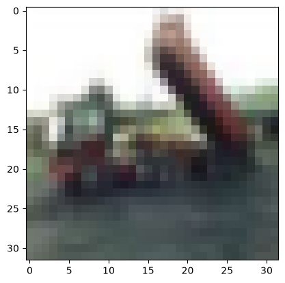

This is the original single-image output from the notebook, not a newly generated sample grid.

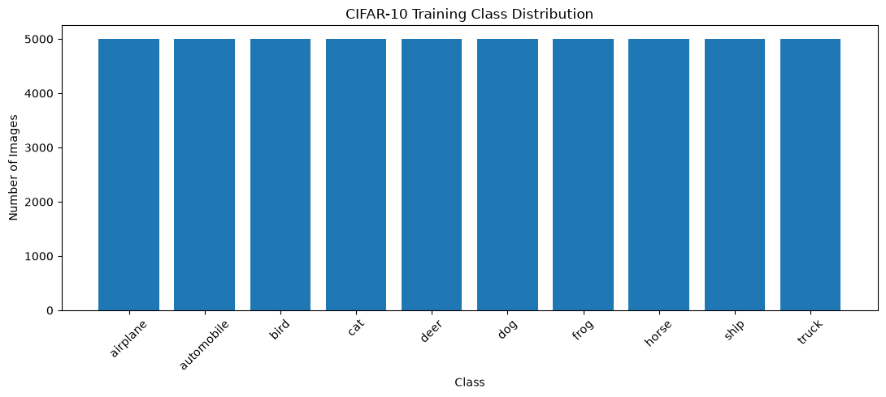

The original training labels are balanced across all ten classes.

## Technologies Used

| Technology | Role |
|---|---|
| Python | Experiment orchestration; notebook metadata records Python 3.12.12 |
| TensorFlow / Keras | CNNs, augmentation, training, callbacks, model serialization |
| NumPy | Array transformations, class counts, predictions, metric calculations |
| Pandas | Training-history tables and experiment comparisons |
| Matplotlib | Learning curves, comparison charts, sample and error visualization |
| Scikit-learn | Stratified splitting, confusion matrices, classification reports, class recall |
| `json` / `pathlib` | Result export and filesystem handling |

Exact dependency versions are not recorded in the supplied files. The notebook kernel version alone is not a complete environment specification.

## Data Preprocessing and Validation

1. Convert image arrays from `uint8` to `float32` and divide by 255, mapping pixel values from `[0, 255]` to `[0, 1]`.
2. One-hot encode labels with `to_categorical(..., num_classes=10)` for categorical cross-entropy.
3. Split the original training data with `test_size=0.1`, `random_state=42`, and `stratify=y_train.ravel()`.
4. Pass the same `(x_val, y_val)` to training callbacks and experiment evaluation.

Augmentation layers are inside the models and apply during training. Validation and ordinary inference use their non-augmented behavior. Dropout likewise acts during training.

Several later model definitions call `tf.keras.utils.set_random_seed(42)`. This is not consistently done before every early experiment, and deterministic operations and repeated-seed trials are not established. Reported results describe recorded runs rather than guaranteed identical reruns.

## Selected CNN Architecture

Experiment 11 retains Experiment 10's six convolutional layers and replaces `Flatten()` with `GlobalAveragePooling2D()`. Each convolution uses **3 × 3 kernels, stride 1, `padding="same"`, a bias, and ReLU**. Each max-pooling layer uses a **2 × 2 window and stride 2**.

Shapes omit the batch dimension. Parameter counts exclude optimizer state.

| Stage | Configuration | Output shape | Parameters |
|---|---|---|---:|
| Input | Normalized RGB image | 32 × 32 × 3 | 0 |
| Augmentation | Horizontal flip; translation ±10% vertically/horizontally, reflect fill | 32 × 32 × 3 | 0 |
| Block 1, convolution 1 | 32 filters | 32 × 32 × 32 | 896 |
| Block 1, convolution 2 | 32 filters | 32 × 32 × 32 | 9,248 |
| Max pooling | 2 × 2 | 16 × 16 × 32 | 0 |
| Block 2, convolution 1 | 64 filters | 16 × 16 × 64 | 18,496 |
| Block 2, convolution 2 | 64 filters | 16 × 16 × 64 | 36,928 |
| Max pooling | 2 × 2 | 8 × 8 × 64 | 0 |
| Block 3, convolution 1 | 128 filters | 8 × 8 × 128 | 73,856 |
| Block 3, convolution 2 | 128 filters | 8 × 8 × 128 | 147,584 |
| Max pooling | 2 × 2 | 4 × 4 × 128 | 0 |
| Global average pooling | Average each channel across its 4 × 4 positions | 128 | 0 |
| Dense | 128 units, ReLU | 128 | 16,512 |
| Dropout | Rate 0.3 | 128 | 0 |
| Output | 10 units, softmax | 10 | 1,290 |
| **Total / trainable** | | | **304,810** |

The final model does **not** use batch normalization, random contrast, or L2 regularization; these are evaluated in alternatives.

### Why Global Average Pooling Helps

Experiment 10 flattens its final `4 × 4 × 128` feature map into 2,048 values. Its next 128-unit dense layer therefore has `2,048 × 128 + 128 = 262,272` parameters. Global average pooling reduces the representation to 128 channel averages, so the equivalent dense layer needs only `128 × 128 + 128 = 16,512` parameters.

This removes **245,760 parameters**, reducing the complete model from **550,570 to 304,810**. Pooling also discards explicit spatial arrangement within each channel, which can be a trade-off. Here it offers a strong accuracy/size balance; the final accuracy change also includes extended training, so it cannot be attributed to pooling alone.

## Model Development and Experiments

The following table transcribes the notebook's **final all-model comparison output**. Accuracy is in percent; cross-entropy is calculated from validation probabilities, excluding L2 penalties. Parameters are total model weights; all are trainable except Experiment 04, which has **447,018 trainable** and **192 non-trainable** parameters.

| Experiment | Main change and comparison context | Parameters | Val. accuracy | Val. cross-entropy |
|---|---|---:|---:|---:|
| 01 — Baseline | Two 4 × 4 convolutions (32/64), pooling, Flatten, Dense(256) | 446,826 | 68.78% | 0.9295 |
| 02 — Dropout | Add Dropout(0.3) after Dense(256) | 446,826 | 70.36% | 0.8739 |
| 03 — RandomFlip | Horizontal flipping + dropout; final row uses overwritten `flip_model` | 446,826 | 72.26% | 0.8217 |
| 04 — BatchNorm | Conv → BatchNorm → ReLU in the flip/dropout architecture | 447,210 | 71.56% | 0.8077 |
| 05 — Translation | Flip + ±10% translation; no BatchNorm; allow 30 epochs | 446,826 | 75.20% | 0.7098 |
| 06 — CNN 3×3 | Replace 4 × 4 with 3 × 3 kernels; retains valid padding | 612,042 | 76.78% | 0.6842 |
| 08 — Deeper CNN | Five same-padded convolutions (32/32/64/64/128); Dense(128) | 402,986 | 79.68% | 0.5950 |
| 09 — ReduceLR | Fresh clone of Exp 08; LR reduction and longer stopping patience | 402,986 | 84.96% | 0.4652 |
| 10 — Deeper CNN | Add a second 128-filter convolution to Exp 09 architecture | 550,570 | 84.70% | 0.4914 |
| **11 — GAP** | **Replace Flatten with GAP; continue training beyond epoch 30** | **304,810** | **85.54%** | **0.4545** |
| 12 — RandomContrast | Exp 11 architecture + `RandomContrast(0.1)`; fresh training | 304,810 | 84.38% | 0.4710 |
| 13 — Dropout 0.4 | Fresh clone of Exp 11 architecture, increasing dropout to 0.4 | 304,810 | 85.54% | 0.4610 |
| 14 — L2 | Fresh clone of Exp 11 architecture; kernel L2(0.0001) on Conv/Dense | 304,810 | 84.10% | 0.4602 |

**Numbering and state caveat:** The final comparison labels the 3 × 3 model as **Exp 06**, although its section and variable are `Experiment 07` / `model_07`. A separate earlier section labeled “Experiment 06” reruns the horizontal-flip model for up to 30 epochs and overwrites `flip_model`. That rerun supplies the final **Exp 03** row (72.26%, 0.8217), whereas the original flip evaluation reports 74.38%, 0.7692. This README follows the final table's numbering without inventing an additional comparison row or hiding the notebook's naming mismatch.

### Experimental Reasoning and Observations

- **Baseline → dropout:** Reduce reliance on individual dense features. Validation accuracy rises from 68.78% to 70.36% in the final comparison.
- **Flipping and translation:** Introduce position/orientation variation. Translation plus flipping reaches 75.20%, but also changes the training budget; this is not a controlled augmentation-only ablation.
- **Batch normalization:** Test normalized intermediate activations. It has lower cross-entropy than the final flip row but lower accuracy. Earlier flip outputs belong to a different model state, limiting direct causal interpretation.
- **3 × 3 kernels:** Smaller kernels improve the recorded validation result, but **increase total parameters** here: valid padding leaves a larger map for Flatten and the dense layer. Kernel size alone does not determine model size.
- **Greater depth:** Experiment 08 adds feature-extraction stages while reducing dense-head width. The resulting 402,986-parameter model outperforms the shallower alternatives.
- **Scheduling:** Experiment 09 reaches 84.96% using the same architecture as Experiment 08. The training policy changes both LR scheduling and early-stopping patience, so the gain cannot be assigned solely to one callback.
- **Another convolution:** Experiment 10 adds capacity but falls to 84.70%, with higher cross-entropy. Greater depth does not automatically improve the result.
- **GAP and continuation:** Experiment 11 reaches 84.84% / 0.4828 after its first 30 epochs. Continuation selects an earlier restored checkpoint with 85.54% / 0.4545.
- **Contrast, stronger dropout, and L2:** None improves on Experiment 11's cross-entropy. Contrast helps some classes while reducing overall accuracy; dropout 0.4 ties accuracy; L2 has nearly comparable cross-entropy but lower accuracy.

These are iterative single-run observations, not statistically isolated estimates of each technique's effect.

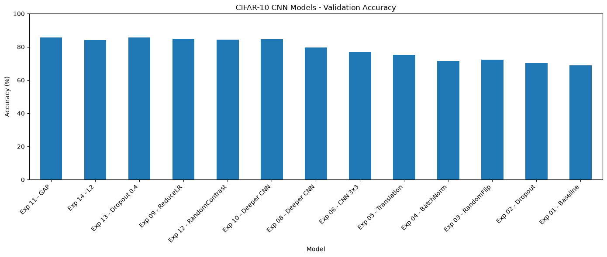

The chart follows the final comparison's cross-entropy ordering. Experiment 11 and Experiment 13 tie on accuracy.

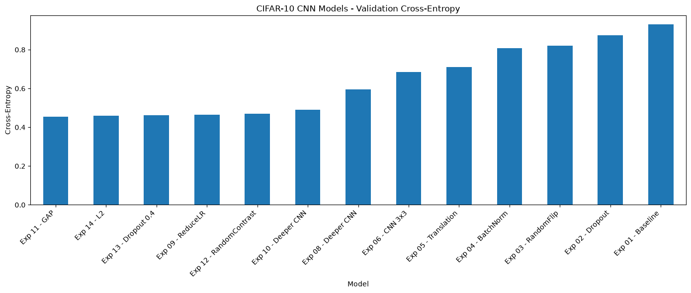

Lower cross-entropy favors Experiment 11. It measures probability quality as well as correct class decisions.

## Optimization and Training Procedure

All models use categorical cross-entropy and Adam. Fitting uses **batch size 64** and the fixed validation split.

| Experiments / phase | Maximum epoch setting | Callback policy |
|---|---|---|
| Baseline, dropout, initial flip, BatchNorm | 15 | EarlyStopping: `val_loss`, patience 3, restore best weights |
| Translation, flip rerun, 3 × 3, Exp 08 | 30 | Same patience-3 policy |
| Exp 09, 10, initial 11 | 30 | ReduceLR: factor 0.5, patience 2, minimum LR 0.00001; EarlyStopping patience 4 |
| Exp 11 continuation | `initial_epoch=30`, `epochs=45` | Fresh ReduceLR callback; EarlyStopping patience 5 |
| Exp 12–14 | 45 | ReduceLR + patience-5 EarlyStopping + best-`val_loss` ModelCheckpoint |

Explicit Adam learning rate is **0.001** for Experiments 09–14. Earlier experiments use `optimizer="adam"` rather than explicitly configuring the rate.

Experiment 11 continues the **existing trained model and optimizer** after its initial run; it is not a new 45-epoch run. The continuation completes epochs 31–37 and restores weights from **epoch 32**, where validation loss is lowest. Its logged training accuracy at epoch 32 is about **89.46%**, distinct from validation accuracy **85.54%**. Epoch 37 reaches a higher validation accuracy of **86.26%**, but has worse validation loss (0.4650), so those weights are not the selected checkpoint.

Experiment 11 is saved manually **after best-weight restoration**; it does not use `ModelCheckpoint` in its own training. Experiments 12–14 save checkpoints automatically. Experiments 13 and 14 clone the architecture with fresh weights; they do not fine-tune the loaded Experiment 11 weights.

### Cross-Entropy Versus Regularized Loss

The final comparison calls `categorical_crossentropy(y_val, predictions)` separately from Keras `evaluate()`. For Experiment 14, Keras evaluation loss is **0.5544**, including L2 penalties; its prediction-only validation cross-entropy is **0.4602**. Comparing 0.5544 directly with an unregularized model's cross-entropy would mix different objectives.

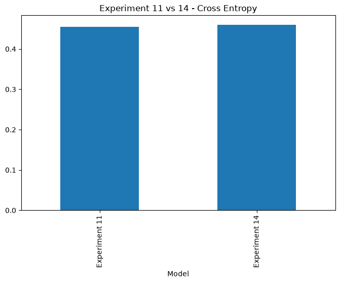

## Training and Validation Curves

### Baseline

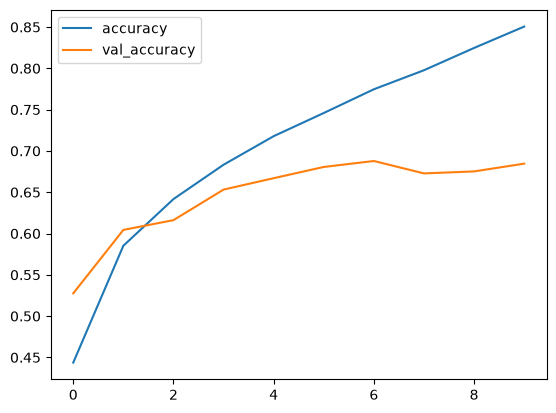

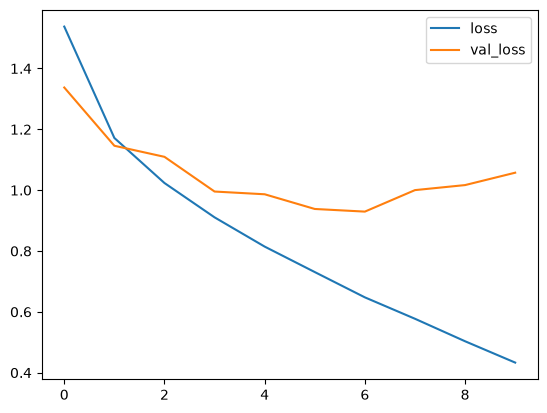

Training accuracy continues rising while validation loss worsens after the best epoch, consistent with overfitting. Early stopping restores epoch 7, rather than retaining the last epoch's weights. The original plots use zero-based history indices, so index 6 corresponds to epoch 7.

### Experiment 11 — First 30 Epochs

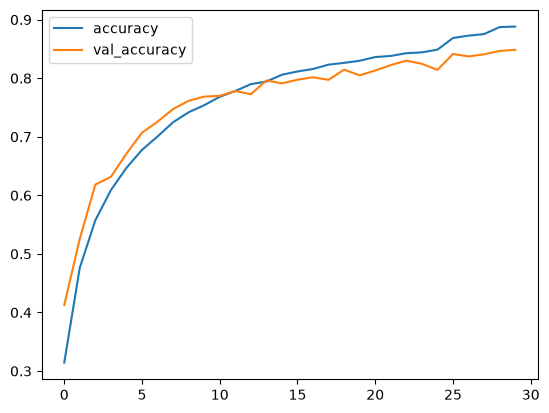

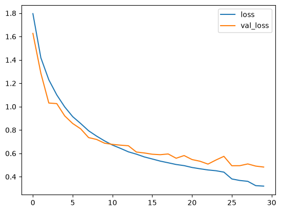

These genuine saved figures cover **only the initial 30-epoch stage**, with zero-based plot indices. They must not be read as complete curves for the extended selected model. Extension metrics exist in text logs and the code combines both histories for CSV export, but no combined-history figure is stored in the supplied notebook. No parameter-comparison chart or architecture image is stored either; the tables above provide those details without fabricating plots.

## Model Evaluation

The final evaluation cell loads `models/exp11_extended_best.keras` and evaluates the 10,000 original test images with batch size 64. Its saved output reports **84.93% accuracy, 0.4850 loss, and 304,810 parameters**. Experiment 11 has no L2 penalty, so this test loss is categorical cross-entropy.

The test set was also evaluated for the baseline during exploration. Model selection is documented primarily through validation comparisons, but this is **not** a workflow in which the test set was never accessed. The 0.61-percentage-point validation–test difference does not prove the absence of overfitting.

### Selected Model: Validation Confusion Matrix

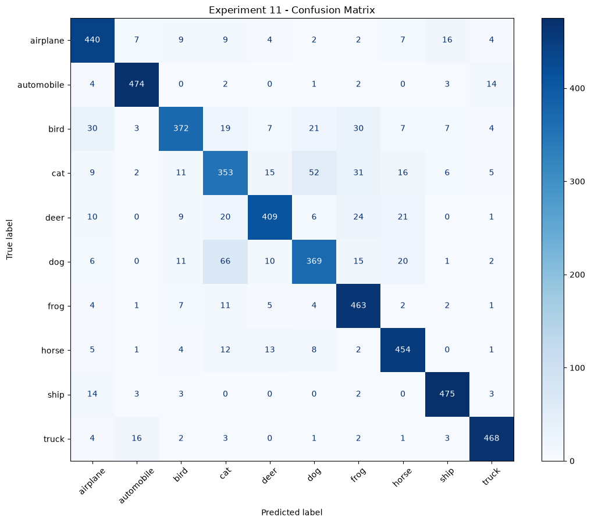

This is a **validation** matrix, not a final-test matrix. Its diagonal totals **4,277 / 5,000 = 85.54%**, consistent with the final comparison.

The corresponding saved validation classification report is:

| Class | Precision | Recall | F1 | Support |
|---|---:|---:|---:|---:|
| airplane | 0.837 | 0.880 | 0.858 | 500 |
| automobile | 0.935 | 0.948 | 0.941 | 500 |
| bird | 0.869 | 0.744 | 0.802 | 500 |
| cat | 0.713 | 0.706 | 0.710 | 500 |
| deer | 0.883 | 0.818 | 0.849 | 500 |
| dog | 0.795 | 0.738 | 0.766 | 500 |
| frog | 0.808 | 0.926 | 0.863 | 500 |
| horse | 0.860 | 0.908 | 0.883 | 500 |
| ship | 0.926 | 0.950 | 0.938 | 500 |
| truck | 0.930 | 0.936 | 0.933 | 500 |
| Macro average | 0.856 | 0.855 | 0.854 | 5,000 |
| Weighted average | 0.856 | 0.855 | 0.854 | 5,000 |

Cats, dogs, and birds have the lowest recall. The selected model confuses **52 cats as dogs** and **66 dogs as cats**. Similar appearance and limited image resolution are plausible explanations, rather than causes established by this experiment.

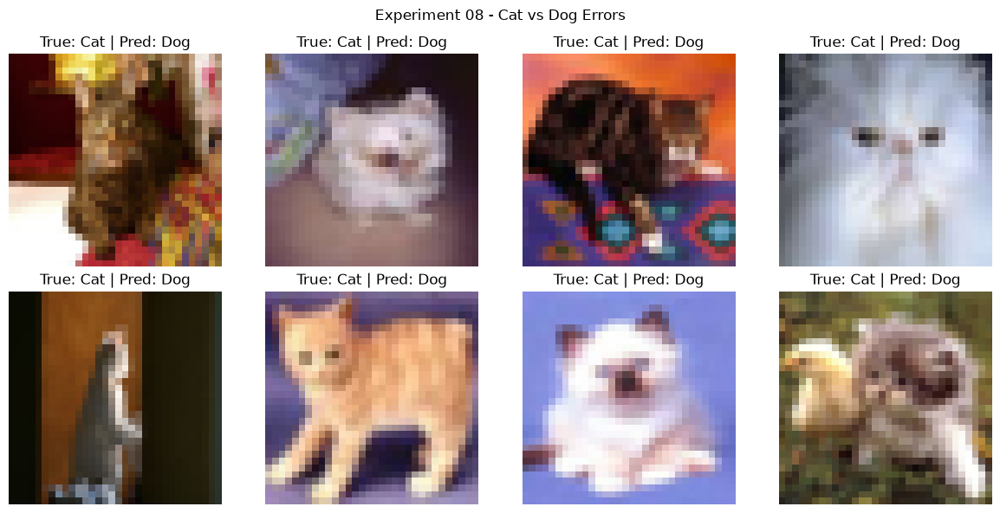

These eight examples come from **Experiment 08**, whose notebook reports 81 cat-to-dog errors. They illustrate earlier error analysis and are not Experiment 11 predictions. No final-test confusion matrix or per-class test report is available in the saved outputs.

## Project Structure and Artifact Availability

Files actually included in this documentation package:

```text
CIFAR10-CNN-Optimization/
├── README.md
├── CIFAR-10 Image Classification.ipynb
├── tools/
│   └── extract_notebook_figures.py
└── docs/
    └── images/
        ├── cifar10-sample.png
        ├── training-class-distribution.png
        ├── baseline-training-accuracy.png
        ├── baseline-training-loss.png
        ├── exp11-first30-training-accuracy.png
        ├── exp11-first30-training-loss.png
        ├── exp11-validation-confusion-matrix.png
        ├── model-validation-accuracy-comparison.png
        ├── model-validation-cross-entropy-comparison.png
        ├── exp11-vs-exp14-cross-entropy.png
        ├── exp08-validation-cat-dog-errors.png
        └── figure-provenance.json
```

The following paths are **referenced or generated by notebook code, but are not included**:

| Path | Intended contents / status |
|---|---|
| `requirements.txt` | Not supplied; no pinned environment could be verified |
| `models/exp11_extended_best.keras` | Selected trained weights; load/save code and outputs available |
| `models/exp11_epoch30.keras` | Initial Experiment 11 stage |
| `models/exp12_best.keras`, `models/exp13_best.keras`, `models/exp14_best.keras` | Alternative best checkpoints |
| `models/baseline_cnn.keras`, `models/cnn_3x3_best.keras` | Earlier saved models |
| `models/cnn_best_09.keras`, `models/cnn_best_10.keras` | Intermediate saved models |
| `models/cnn_deeper_best.keras` | Misnamed export: code saves `model_07`, not `model_08` |
| `results/model_comparison.csv` | Export code and complete printed comparison available; CSV absent |
| `results/final_test_results.json` | Export code present with no execution count or saved output; JSON creation unconfirmed |
| `results/experiment_11_extended_history.csv` | Combined-history export code and success message available |
| `results/experiment_06_history.csv`, `results/experiment_08_history.csv`, `results/experiment_09_history.csv`, `results/experiment_10_history.csv` | Earlier history exports |
| `results/experiment_12_history.csv`, `results/experiment_13_history.csv`, `results/experiment_14_history.csv` | Alternative history exports |
| `results/experiment_11_report.txt` | Validation classification-report export |
| `results/all_models_accuracy.png`, `results/all_models_loss.png` | Plot save calls; embedded equivalents extracted into `docs/images/` |
| `results/experiment_10_confusion_matrix.png` | Earlier validation matrix export |

Missing weights cannot be recovered from learning curves or notebook summaries. No claim is made about checkpoint tracking on GitHub or an external download location.

## Installation and Setup

Clone the repository using its actual URL; none was supplied for this documentation:

```bash
# Set REPOSITORY_URL to the actual GitHub repository URL first.
git clone "$REPOSITORY_URL" CIFAR10-CNN-Optimization
cd CIFAR10-CNN-Optimization
python -m venv .venv
```

Activate the environment:

```bash
# Linux / macOS
source .venv/bin/activate
```

```powershell
# Windows PowerShell
.venv\Scripts\Activate.ps1
```

Because `requirements.txt` is absent, the following is an **unpinned starting environment**, not a reconstruction of the original training environment:

```bash
python -m pip install tensorflow numpy pandas matplotlib scikit-learn notebook
python -m notebook "CIFAR-10 Image Classification.ipynb"
```

Alternatively, open the notebook in VS Code with a Jupyter-capable Python environment. Package compatibility and numerical reproduction have not been tested here. Once the original working environment is available, export and review its actual dependency versions rather than assigning guessed pins.

## How to Run

### Inspect Existing Results Without Training

Open the notebook and review its saved outputs. The README and extracted figures require no model weights or TensorFlow execution. To regenerate the same selected image files using only Python's standard library:

```bash
python tools/extract_notebook_figures.py
```

The script reads saved PNG MIME payloads, preserves their original bytes, and writes source cell/output indices and SHA-256 hashes to `docs/images/figure-provenance.json`.

### Reproduce Training

The notebook is an exploratory record with execution-state issues. Before running it in a fresh kernel, apply the small corrections documented below in a working copy. Run imports, data loading, normalization, encoding, and splitting in order, then model construction and fitting in dependency order. Data loading may download CIFAR-10 if it is not cached.

For Experiment 11 specifically, execute its model definition, initial 30-epoch fit, continuation, and save cells in that order. Experiments 13 and 14 require the Experiment 11 checkpoint to exist before cloning its architecture. Full comparison requires the earlier in-memory model variables as well as the available checkpoints; the cell can skip unavailable models.

Training cells save or overwrite local paths, so use a separate working directory when preserving existing checkpoints. Reproduction was not run during documentation.

### Use a Saved Experiment 11 Checkpoint

This path works only after the original checkpoint is supplied or training produces it. After preprocessing has defined `x_test` and `y_cat_test`:

```python
from pathlib import Path
import numpy as np
from tensorflow.keras.models import load_model

checkpoint = Path("models/exp11_extended_best.keras")
if not checkpoint.is_file():
    raise FileNotFoundError("Supply or train the Experiment 11 checkpoint first.")

final_model = load_model(checkpoint, compile=False)
final_model.compile(
    optimizer="adam",
    loss="categorical_crossentropy",
    metrics=["accuracy"],
)
test_loss, test_accuracy = final_model.evaluate(
    x_test, y_cat_test, batch_size=64, verbose=0
)
probabilities = final_model.predict(x_test[:8], verbose=0)
predicted_classes = np.argmax(probabilities, axis=1)
```

Input arrays must already be RGB `float32`, shaped `(N, 32, 32, 3)`, normalized to `[0, 1]`. The model contains augmentation but no input-rescaling layer. The example illustrates inference/evaluation and was not executed without the checkpoint.

## Reproducibility Issues Found

The original notebook has been preserved without edits. Before a clean end-to-end run:

- **Class-name variable:** The dataset section defines `CLASS_NAMES`, but later evaluation uses undefined `class_names`. Define `class_names = CLASS_NAMES` before those cells in a working copy.
- **Incorrect model export:** The Experiment 08 save cell writes `model_07` to `models/cnn_deeper_best.keras`. Save `model_08` there when intending to export Experiment 08.
- **Reused variables and inconsistent labels:** The flip rerun overwrites the earlier model/history, and the 3 × 3 section is called Experiment 07 while the final table calls it Experiment 06. Preserve this mapping when interpreting old results.
- **Stale printed baselines:** Some comparison cells print hard-coded earlier scores (for example, baseline 67.96% / 0.9124), inconsistent with actual baseline evaluation and the final table. The documented baseline uses 68.78% / 0.9295.
- **Mixed execution state:** Counts are out of order and some populated cells have no execution count. Stored outputs are evidence of recorded sessions, not proof that the current source was executed cleanly from top to bottom.
- **Missing original environment and artifacts:** No supplied checkpoints, CSVs, JSON, or pinned requirements support independent metric recomputation. The JSON export cell's validation metrics are hard-coded; final test metrics are taken from evaluation variables.

## Key Findings and Limitations

Global average pooling substantially reduces dense-head size, while validation-guided scheduling and architectural changes yield a strong improvement over the baseline. More layers, more augmentation, and stronger regularization do not consistently improve every metric. Accuracy and cross-entropy can rank alternatives differently.

The study uses one validation split repeatedly, with no independent repeated-run uncertainty estimates. Architecture, training duration, and callback settings sometimes change together, limiting causal comparisons. Low-resolution CIFAR-10 images constrain fine-grained recognition, and performance on this balanced benchmark does not establish robustness to real-world image distributions. The training/validation gap and prior baseline test access remain relevant when interpreting the final score.

## Future Improvements

- Fix notebook execution and export issues; provide the original checkpoints and verified environment specification.
- Repeat selected models across random seeds and report mean, spread, and compute cost.
- Run controlled ablations with matched training budgets.
- Compare residual architectures and transfer learning as new baselines.
- Evaluate systematic hyperparameter search, calibration, and robustness.
- Add a separate inference demo or deployment once checkpoint availability is resolved.

These are proposed extensions, not completed features.

## Author

**Maen Qawasmeh**
